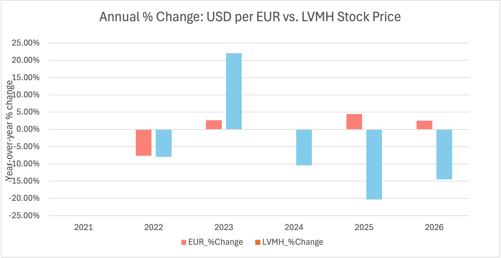

# Dollar Strength vs. LVMH Stock Price

**Author:** Antonia Velasquez
**Status:** Version 1 (annual data). Version 2 with monthly data is in progress.

## Question
When the dollar weakens against the euro, does LVMH's stock price tend to rise or fall?

## Hypothesis
It tends to fall, because a stronger euro makes LVMH's foreign earnings worth less when converted into euros.

## Data
- **Broad U.S. Dollar Index (DTWEXBGS)** and **U.S. dollars per euro (DEXUSEU):** FRED, Federal Reserve Bank of St. Louis (fred.stlouisfed.org). Original downloads are in `data/raw/`.
- **LVMH daily closing price (EPA:MC, in euros):** Google Finance, pulled with the GOOGLEFINANCE function in Google Sheets. Included in the workbook for educational purposes (see the data note below).
- **Period:** October 2021 to October 2026

### Data note
The LVMH price data belongs to its original providers and is included here only for educational, non-commercial use, to make this analysis easy to follow. If you are a rights holder and would like it removed, please contact me and I will take it down.

## How to reproduce the LVMH data
1. Open a blank Google Sheet.
2. Paste this formula in cell A1:

   `=GOOGLEFINANCE("EPA:MC","close",DATE(2021,10,18),TODAY(),"DAILY")`

   If your Google Sheets uses a different regional format and shows an error, replace the commas with semicolons.
3. The sheet returns two columns: date and closing price (in euros).

Prices change over time, so a new run may differ slightly from the figures reported here.

## Method
Cleaned the data in Excel, calculated annual averages with PivotTables, and compared year-over-year percentage changes.

## Results

| Year | USD per EUR | LVMH |
|---|---|---|
| 2022 | -7.66% | -7.98% |
| 2023 | +2.68% | +22.08% |
| 2024 | +0.03% | -10.43% |
| 2025 | +4.49% | -20.29% |
| 2026* | +2.50% | -14.49% |

*2026 is a partial year.

The evidence is mixed. In 2025 and 2026 the euro strengthened and LVMH fell, which is consistent with the hypothesis. In 2022 and 2023 the two moved in the same direction, which is not. In 2024 the euro barely moved.

## Limitations
- Only five annual data points
- 2021 and 2026 are partial years
- Many other factors affect LVMH (China demand, inflation, tariffs)
- This analysis shows co-movement, not causation

## Next steps
- Monthly data with correlation and regression
- Compare euro-reporting and dollar-reporting luxury companies
- Tableau Public dashboard

## Files
- `analysis/dollar-lvmh-analysis-v1.xlsx`: workbook with the FRED data, LVMH prices, PivotTables, annual summary, and notes
- `data/raw/`: original FRED downloads
- `images/`: charts

## Disclaimer
This is a student learning project, not investment advice.
